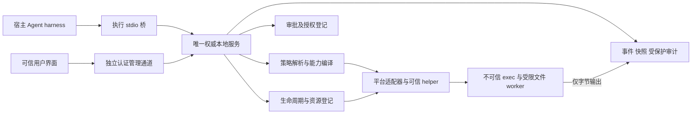

# 本地服务实验契约：架构协调草案

日期：2026-11-04。版本：`sandbox.architecture/0.1.0-draft.1`。**未实现、未批准、不得据此宣称外部客户端兼容。** 所有字段、方法、数值和状态名称均不稳定；D1–D7 未确认前不发布稳定 schema。

本草案保留 PUSH-7 `sandbox.integration/0.1.0-draft.1` 的请求/输出基础语义，补 C1–C6、SESSION-01 和 PUSH-8 评审缺口。两个版本不相等；旧夹具不是本版的兼容测试。新增服务拓扑、快照游标、环境修订、文件操作去重和审批决定键需相关角色先评审再迁移。原 M0 报告 `schema_version=1.0` 与两种服务草案都无版本关系。

## 1. 模块与信任边界



| 模块 | 权威职责 | 明确边界 |
|---|---|---|
| 接入层/stdio 桥 | 版本与帧处理、执行工具路由、原始 owner 断连传递、隐藏授权元数据 | 不自行裁决策略；模型不能调用管理接口；桥不能吞掉上游 EOF 并继续保活 |
| 服务身份与对象存储 | 从认证上下文派生主体/角色；环境 revision、session 归属和方法级权限 | 客户端的 role/user/PID/clientName 只作诊断，不能建立权限 |
| 纯策略与 core | 纯规则合并；OS 路径解析、有效策略、能力检查、不可表达拒绝 | 路径解析访问 OS，非纯函数；policy.explain 不授予实际操作能力 |
| 授权模块 | pending request、审批决定、grant 原子消费、撤销与期限 | secret/ref 不到模型或负载；批准不启动执行 |
| supervisor | 请求去重、任务/会话状态、超时仲裁、回收、残留隔离 | 实际状态不从 UI、负载 stdout 或 RPC 等待超时推断 |
| 平台适配器/helper | 约束在负载前生效、自检、原生句柄/进程树控制、清理证据 | 必需能力失败不得回退普通进程；内部接口不公开稳定 trait |
| 文件 worker | 同策略 read/list/search/write/apply_patch，受限句柄解析与内容冲突检查 | 不让 supervisor 用宿主权限替负载任意读写；单文件 patch，无多文件事务承诺 |
| 控制台 | 展示可信快照、请求审批/取消/关闭；纯文本显示不可信输出 | 按对象授权；状态只能服务确认，不能自己删目录/kill PID/解除隔离 |
| 构建/安装 | 组件版本和来源、受信安装、升级/回滚 | 服务负责排空和资源确认，安装器不能直接替换运行中 helper |

控制台 I01–I14 对应：I01/02 接入＋身份/能力；I03/04 配置＋策略；I05/06/08 supervisor；I07 worker；I09/13 事件审计；I10/11 授权；I12 资源恢复；I14 构建与服务排空。模块命名不决定语言或框架。

## 2. 身份、授权引用与多连接

候选拓扑采用一份权威服务实例，通过受保护原生 IPC 接受执行桥和控制面连接。执行桥可继续向 Agent 暴露 stdio JSONL。单独启动两个 stdio server 不会因为 session ID 相同而共享会话。

安装/可信启动器建立服务身份和控制主体登记，管理端点检查操作系统对端身份及受保护的连接引导凭证。凭证只交给经验证的可信 UI/宿主组件，以专用受保护句柄或等效安全通道交付，不通过 argv、仓库文件、负载环境或可读日志。服务绑定连接到安装身份、主体、角色、连接代次；双方验证实例身份，避免连到假服务。每个请求再次检查方法与对象权限。具体密钥存储、挑战证明、轮换和平台实现由安全设计核验，**仅凭同一 OS 用户/loopback 地址不通过认证验收**。

Unix socket 权限/对端凭据和 Windows named pipe DACL/对端身份是候选原语，仍须证实 worker 无法访问/继承端点、窃取句柄、调试服务或借宿主代理访问。缺此证明时多客户端审批能力为 unverified，拒绝依赖它的 session；不能放行后只给警告。浏览器若被选择，需要单独受信本地桥、来源校验、CSRF/重绑定防护和凭证保管设计，不能直接接入未认证 loopback HTTP。

一个 session 绑定一个执行主体与一个 owner 连接代次；服务决定可观察/可审批/可管理的其它主体。只有执行 owner 可新建操作和权限申请；指定 approver 可处理分配给其权限范围的审批；管理员可关闭/恢复被授权对象；observer 只有读取权。控制台可同时拥有多个角色，但角色分别校验，在线不自动成为 owner。

服务生成 `instanceId`（每次重启变化）、`sessionId`、`execId`/`operationId`、`approvalRequestId`。对象 ID 非授权能力，不因猜到 ID 获得可见性。授权记录存在服务端，可信 harness 可持不透明 `grantRef`，它仍需认证/对象绑定并不单独构成 bearer 权限；禁止出现在模型 schema、上下文、worker、日志。示例中的 ID 均为合成占位值，不是可用凭据。

## 3. 环境、策略与会话

环境 E 是持久配置，包含工作区登记引用、策略意图及工具链 profile，不含活进程或 grant。`environment.save` 带 `expectedRevision`；服务原子比较、校验、保存 R+1。会话创建固定 R、来源、硬上限、规范化规则版本、policyHash、后端配对和 capabilities。保存 R+1 不修改 R 会话；立即收紧旧权限需关闭/撤销旧会话。

删除配置默认在活动 session 或残留资源存在时返回 `EnvironmentInUse`。删除与 session.create 由服务同一事务/对象锁仲裁；显式关闭全部相关会话、确认清理后才能删除。配置删除不删除工作区或默默触发卸载；旧审计按留存规则保留。

初始实验 profile：每个工作区登记对象最多一个活动 session；同一 session 至多一个在途 exec 或文件操作（含读，避免读取写入中间态）。服务总计最多四个在途操作，超限 `Busy`，无隐式队列。后续并发 profile 需另验收。工作区冲突按服务解析的卷/对象/祖先范围及共享 Git 元数据判断，不能按路径字符串或环境 ID 判断；无法排除别名和共享风险时拒绝组合。不同权限任务不能复用仍被低权限后代持有的工作区/缓存；grant 增量需确认旧操作清理并隔离其可变输入，否则拒绝。

请求的 PolicySpec、ResolvedPolicy 和 EffectivePolicy 分开。后者返回 policyHash、配置 revision、硬/软规则及来源、工作区模式、实际网络模式、runtime profile 和能力缺口。客户端把 hash 视作服务生成的不可解释标识；服务按版本化规范化规则生成 hash 和请求摘要，未知规则版本不能跨组件比较。完整摘要包括 argv、解析后的 cwd/对象域、env、stdin 字节摘要、timeout/输出限制、文件内容和目标、策略/权限绑定；排序 JSON 键不改变语义。requestKey 和 RPC id 不属于操作意图摘要；去重记录另比较全部控制绑定。

硬/软限制按 [0002](../decisions/0002-m0-architecture-proposal.md) 执行；保护规则默认硬限制，Git 写 grant 在当前 profile 中拒绝。能力不足时，创建返回结构化拒绝和缺项，用户负载启动数为 0。

## 4. 生命周期、断连与竞态

Session：`creating → ready → closing → closed | closed_incomplete`，也允许 `creating → closing`；准备失败保留 `creation_failed` 及独立 cleanup 结果，不返回可用会话。客户端无法确认状态时显示 `unknown`，不把它作为服务终态。服务先登记创建意图、分配 sessionId 并绑定 owner，再准备任何 helper/私有资源；session.create 返回该 ID 和 creationState，只有 ready 可执行。创建完成、owner 断连、显式关闭和准备失败由同一状态机原子仲裁。

Operation：`accepted → preparing → running → terminating → terminal`，可从 preparing 以 setup_failed 终结，也可从 running 自然退出。普通非零退出为 `exited`，不是 PolicyDenied。`exec.start` 只承诺已接受；没有启动用户负载也必须报告已接受操作的终态。普通 exec 完成仅清理本次进程/后代，session 保持 ready；清理失控时由服务明确升级为关闭会话。

| 事件 | 服务原子步骤与结果 |
|---|---|
| owner EOF/协议致命错误/存活检测超时 | 把 creating 或 ready 改为 closing，增加 session generation、阻断新操作与新授权；使 pending 失效、撤销所有 grants；终止并核验资源 |
| observer 离线 | 只关闭订阅，不影响 owner；重连只能按权限读快照/记录 |
| approver 离线 | 不批准；待审请求按原期限继续存在。owner 断连使其立即失效，UI 不能延长期限 |
| late approval / 新 exec | 关闭先赢则 SessionClosing；批准先赢但尚未消费则撤销；消费先赢则已有操作进入取消/回收 |
| cancel / timeout / 自然退出 | 服务按持锁登记的先后确定结束原因；已登记自然终态不被晚到 cancel 改写。取消被接受不表示已停止或已回收 |
| 重复 close/cancel | 经鉴权返回当前或原终态，不再次启动清理副作用；残留重试用独立管理操作与键 |

grant 消费、操作登记和 closing 使用同一原子仲裁边界。关闭与平台启动串行化：关闭已生效时不能 resume 用户负载；已授权启动先赢时也必须立即纳入关闭回收，不能出现未登记进程。资源先登记后暴露，准备失败和服务崩溃都能追踪。creating 中关闭先赢时，即使 helper 随后报告准备成功，也不得转 ready 或启动负载；新返回的资源同样纳入收尾。创建先转 ready 则按正常关闭路径回收；已有创建失败结果不被覆盖，只补后续资源回收记录。客户端即使从未收到创建 ACK，服务仍承担已登记创建的清理责任。

实验期限：owner 管道 EOF 立即触发；原生 IPC 心跳每 2 秒、服务单调时钟 6 秒未收到认证存活信号视作断连；桥上游 EOF 立即关闭对应 owner。准备 10 秒、终止宽限 2 秒、清理核验 10 秒；运行超时由请求给定、上限 300 秒且从用户负载实际启动计算。发送阻塞另按第 6 节处理。数值仅用于可重复实验，初始化返回实际值，不是性能 SLO。M1 不做 owner 接管、重连续跑或后台任务；观测链路恢复不能恢复执行授权。

## 5. 幂等、审批与副作用

先认证并验证对象读取权，再查去重记录；重试不能绕过鉴权泄露旧结果。变更请求必须带 initialize 返回的 `expectedInstanceId`，不匹配返回 InstanceMismatch，不能把旧请求移到新实例执行。变更请求必须有 key，命名空间为 instance＋主体＋session（环境操作改用 environment）＋方法族。RPC id 只关联一次传输。

session.create 是显式例外：分配 session 前，以 **instance＋认证主体＋session.create＋requestKey** 原子登记创建意图，记录环境ID/revision、全部请求参数、原 owner 连接代次及生成的 sessionId；owner 代次是记录绑定，不纳入键空间，防止重连复用同键意外创建第二份资源。拒绝/失败结果也保留。同主体同键同内容返回原创建记录，优先于容量/工作区冲突判定；同键异内容返回 DuplicateKeyConflict。`session.creation.get` 接受原 instanceId/requestKey，仅向相同主体或明确获授权管理者返回脱敏创建记录。原连接丢 ACK 可查/重试；原 owner 已断时，新连接只能查原记录，不能接管、恢复创建或复活 session；新的创建意图必须显式使用新 key。未查明原结果时不得自动创建替代会话。创建记录按主体最多10,000条、终结后24小时留存，受总存储限额约束；达到上限拒绝新建但保留查询/关闭能力，过期返回 ResultExpired，不把旧键重新当新创建。过期键以墓碑保留至实例结束，同样计入该10,000条上限，达到上限拒绝该主体的新创建；重启后以expectedInstanceId拒绝旧请求。

- 同 key、同规范化请求及控制绑定：返回同 operation/决定，**先查旧记录，不重新消费 grant或检查旧文件摘要后再写**；终结或关闭会话仍可按权限查询既有结果。
- 同 key、不同请求/绑定：`DuplicateKeyConflict`，不执行。不同 key 的新意图重新校验当前权限，关闭/过期/撤销均拒绝。
- session 内去重记录不提前淘汰；实验上限每会话 10,000 个变更键，到上限拒绝新增、仍允许关闭/取消/查询。关闭后结果保留 24 小时；到期 `ResultExpired`，旧 session 永不复活，不将旧键视作新执行。
- 服务重启使所有旧 instance/session/grant 失效，不自动重放。持久审计可能仅能证明“已接受”，不能证明副作用有没有发生；此时 `OutcomeUnknown`。请求方需人工/业务核对后显式新意图，不承诺 exactly-once。

`permissions.request` 保存不可变意图、原 policyHash、主体/session/generation、具体软规则增量、用途、期限、可选 retryOf。请求摘要覆盖操作输入；被引用脚本若可变，审批说明必须按资源权限授权，或使用可信快照绑定内容，不能声称已审核后来替换的脚本。

`approval.resolve` 只从可信控制面接收，带 `decisionKey` 和待审 revision。服务原子 CAS 决定 pending 为 approved/denied；同 key同决定重试返回原决定，不新签 grant；不同 key 再处理已决审批返回 `ApprovalAlreadyResolved`。批准 ACK 丢失先查询/用原 key 重试。批准不运行原请求，harness 显式提交新的执行 key。

once grant 绑定 instance、执行主体、session/generation、policyHash、软规则增量、有效期、审批 ID及不可变操作意图；新执行启动准备前原子消费并记录操作 ID。准备失败也不退回消费，重试已有 key仅查原失败，新执行需新审批。session grant 绑定相同公共字段但绑定可复用权限范围，每次操作重新检查，不以命令前缀通配；本实验同样不允许与旧低权限负载共享可变资源。实验审批 TTL 上限 60 秒，grant TTL 上限 300 秒且不超过 session 存活，服务单调时钟判断；墙钟只用于展示/审计。

撤销立即禁止新消费，并取消受该 grant 授权且可能持有存量 FD/网络连接的操作；无法收窄到操作时关闭会话。所有旧句柄/连接经核验终止前不能报告“即时撤销完成”。即便取消成功，也不回滚文件或远端副作用。

文件写/patch 的 requestKey 在首次发送前确定；带 expectedSha256 或 expectedAbsent，限定单文件及大小。ACK 丢失的同键重试返回原 operationId/结果，不能因当前 hash 已变而重新执行；不同键仍做版本冲突检查。worker 需以受限父目录/对象句柄实现检查与替换，验证内容检查到落盘之间的竞态；无法提供声明的单文件写语义则拒绝，不以宿主文件 API 兜底。

## 6. 帧、事件、快照和有界资源

线协议为 UTF-8 JSONL/JSON-RPC 2.0，拒绝 BOM、batch、重复 JSON 键、未知安全字段及非有限数字。非空字符串 RPC id 在在途请求中唯一。首请求 initialize 精确协商本草案版本；不兼容禁建会话/禁写/禁批，仅在双方明确支持独立只读诊断版本时可诊断。server stdout 仅协议、stderr 脱敏诊断，负载 stdin/stdout/stderr 为不同句柄。

单帧含 LF ≤1,048,576 字节；输出块解码后 ≤16,384 字节；单次 stdin 与文件写/patch 解码后 ≤262,144 字节，同时仍受编码后帧长限制。文件读/search 必须分页并受单响应大小约束。字节仅用 `{encoding:"base64",data:"..."}`；无 UTF-8 假设。M1 默认 stdin 关闭，有界数据写完 EOF；PTY/resize/持续输入返回未支持。

stdout/stderr 总留存每操作 ≤10,485,760 原始字节，超过继续排空并累计 droppedBytes。owner 输出队列编码后 ≤1,048,576 字节，持续无法发送 5 秒则取消并关闭会话；不能只等读端永久恢复。observer 使用独立有界队列；落后时断开订阅并标记 gap，不取消 owner。控制状态不因输出队列满被静默丢弃，保存在权威快照/审计。

每会话 `eventCursor` 从 1 递增，服务在同一事务中更新状态并登记事件；快照返回状态以及覆盖的 cursor C。客户端应用 C 后的事件，重复 cursor 去重，缺口重取快照，不用旧事件覆盖新状态。无读取权不建立订阅；有读取权但敏感字段需隐藏时发送同 cursor 的脱敏占位事件，使游标连续且不泄漏内容。每 exec 同时有从 1 递增的 seq（沿用接入草案）；跨 exec 按 eventCursor 排序，不要求两个序列数值相同。

start 响应排在同连接对应事件前；丢 ACK 不代表没执行。`exec.completed` 在输出排空或明确截断、清理结果确定后生成一次，之后该 exec 无输出；网络可重复投递相同事件，客户端去重。`cleanup.incomplete` 可成为完成结果，不等待无限清理；后续恢复以独立 recovery 事件报告，不改写原执行历史。保留最近 1,000 条事件且每会话编码总量≤1 MiB；超出只删旧事件并返回 `EventsExpired`＋快照，不删除去重键。输出内容单独按限额保存，事件可引用片段，丢失明确标记。

服务实验总配额：最多 8 个 session、16 个连接、4 个在途操作、持久审计及结果合计 256 MiB；到限拒绝新任务，不删除活动去重或必需审计来继续。结果24小时留存受总配额限制：空间不足先拒绝新任务，不能提前无声淘汰。上述上限需初始化完整返回，生产值待资源测试。

## 7. 错误、能力与恢复

保留 PUSH-7 的 -32001…-32008 含义：VersionMismatch、UnsupportedCapability、PermissionDenied、DuplicateKeyConflict、Busy、FileConflict、SessionClosing、NotInitialized。新增草案业务错误统一暂用 -32020，`data.kind` 区分，不复用旧码表达不同语义。

| kind | 处理含义 |
|---|---|
| InvalidPolicy / UnsupportedPolicy / BackendUnavailable | 尚未启动用户负载；附字段/规则/缺失能力，不能降级运行 |
| ApprovalRequired / ApprovalDenied / ApprovalExpired / ApprovalAlreadyResolved / GrantInvalid | 审批/授权状态；不得自动重跑 |
| PolicyDenied | 仅在服务/后端可信证据足以识别规则时返回，附 ruleId/evidenceRef |
| EnvironmentInUse / RevisionConflict / ResultExpired / EventsExpired / AuditUnavailable / InstanceMismatch | 对象/留存/审计/实例约束；查询服务并按明确的新意图处理 |

SetupFailed、Cancelled、TimedOut、ResourceExceeded 作为已接受操作的 outcome，不把终结事件伪装成 exec.start 从未接受。结果同时含 exitCode/platformStatus、policyHash、backend、输出统计、cleanup、knownDenials 与 `sideEffectsMayHaveOccurred`。普通命令非零退出仍为 exited。ServiceUnavailable/OutcomeUnknown/InvalidServerFrame 是客户端诊断，不伪造服务器响应。

能力报告最少包含 instance、OS/架构/内核或构建号、backend/helper版本与摘要、安装权限/来源、policy语义版本、检查时间和证据引用。每能力区分 `verified / unsupported / unavailable / unverified`，并说明作用范围与限制；对每项 required 必须是当前环境 verified。doctor 结果不替代启动前的对象/约束检查。协议本身支持某字段不等于后端可强制它。

cleanup 的声明等级 `guaranteed / best_effort / unsupported / unverified` 与每次状态 `pending / complete / incomplete / unknown` 独立。guaranteed 仅可在支持条件和真实回归证明成立时声明，当前探针不得填 guaranteed。清理报告含资源 ID、类别、确认依据与失败原因，不暴露可由 UI 任意删除的路径。

服务在受保护位置记录资源归属、实例代次和强身份。重启先标旧会话 unknown、撤销所有旧 grant/句柄、隔离受影响资源，再依据原生可验证句柄/标识及持久登记恢复；PID 单独不足，PID＋启动时间也只是相应平台证据的一部分。不能凭旧路径或名字杀进程/递归删除；无法确认归属保持 quarantined，交管理恢复。只有受影响范围不可复用，无关会话不误清理。升级先禁新请求、排空或终止并确认清理，再换组件；旧会话不迁移。

实验默认完整审计：accept/start/approval/grant consumption/exit/cleanup 在受保护有界存储记录，脱敏且不记秘密或默认全量输出。写入必需审计失败时停止新执行/批准/消费，取消受影响活动操作，尽力完成清理并显式标审计缺口；磁盘故障时不声称完整记录。即使将来选择普通诊断模式，身份、授权/去重及资源登记的必要写入失败仍不得继续敏感操作。普通诊断丢日志是否允许继续需可信配置明确声明。

## 8. 示例（提案数据，不是运行证据）

示例省略完整握手返回表；真实实现不能省略上述限额/配对/能力字段。`workspaceRef` 由服务预登记，不能将 URI 当宿主路径。环境创建需要真实后端满足所有 required。

```json
{"jsonrpc":"2.0","id":"init-1","method":"initialize","params":{"protocolVersions":["sandbox.architecture/0.1.0-draft.1"],"client":{"name":"fixture-harness"}}}
```

```json
{"jsonrpc":"2.0","id":"session-1","method":"session.create","params":{"expectedInstanceId":"I1","requestKey":"create-S1","environmentId":"E1","expectedRevision":3,"requiredCapabilities":["fs.scoped","fs.protected","network.deny","worker.same_policy","cleanup.guaranteed"]}}
```

```json
{"jsonrpc":"2.0","id":"start-1","method":"exec.start","params":{"expectedInstanceId":"I1","sessionId":"S1","requestKey":"run-01","argv":["fixture-tool","check"],"cwd":".","env":{},"stdin":{"encoding":"base64","data":""},"timeoutMs":10000}}
```

```json
{"jsonrpc":"2.0","method":"exec.completed","params":{"sessionId":"S1","execId":"X1","eventCursor":4,"seq":2,"outcome":"exited","exitCode":1,"policyHash":"fixture-policy-hash","backend":"fixture-only","outputTruncated":false,"droppedBytes":0,"cleanup":{"status":"complete","evidenceRef":"fixture-evidence"},"sideEffectsMayHaveOccurred":true}}
```

```json
{"jsonrpc":"2.0","id":"late-approval","error":{"code":-32007,"message":"Session is closing","data":{"kind":"SessionClosing","sessionId":"S1"}}}
```

fixture-tool/backend/evidence 均不是实际可执行后端。完整真实验证步骤见[验证场景](m0-contract-validation.md)。
