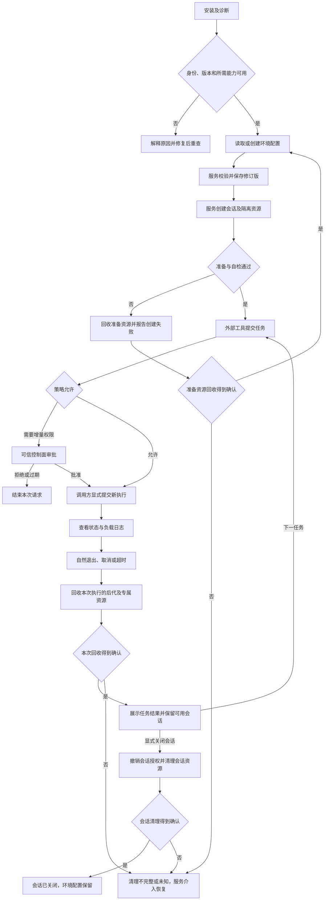

# 环境、会话与用户流程

状态：M0 候选设计；基准：v0.2 §§3.2、6、11、12。以下“必须”是控制台验收要求，“建议”是待协调实现选择，均不表示功能已经存在。

## 对象与持久性

| 对象 | 用户含义与来源 | 存活与边界 |
|---|---|---|
| 环境配置（候选新对象） | 一个命名工作区及其策略、工具链、资源要求；由本地服务存储并返回版本 | 持久；保存不启动负载，不代表策略可表达；不保存 grant、会话私有 HOME/temp 或运行句柄 |
| 会话 Session | 本地服务以固定配置版本创建的执行信任域 | 临时；绑定主体、所属连接、工作区、策略 hash、后端与能力快照；关闭撤销授权并回收资源 |
| 任务 Exec / 文件操作 | 外部工具提交的 argv/cwd/env/有界输入，或同策略文件 worker 请求 | 属于单一会话；独立 exec 不继承前次 cd/export；文件操作也有可关联的操作 ID |
| 审批与授权 | 服务根据真实请求产生待审对象，可信控制角色提交决定 | 请求 ID 可展示，授权凭证不能交给模型或负载；once/session 均不跨会话或重启保存 |
| 运行结果与审计 | 服务确认的退出、拒绝、清理、策略及操作记录 | 按有界留存策略持久化；不等于仍存活的会话；负载日志与可信审计分开 |

建议 C1：**一个持久环境配置可产生多个临时会话，每个会话固定一个配置修订版**。配置改动只用于新会话，旧会话保留旧有效策略；需要立即收紧已有权限时走服务撤销/终止流程。环境是管理对象，不暗示 VM、容器、持久 shell 或新的隔离保证。

| 候选 | 收益 | 代价与判定条件 |
|---|---|---|
| A：环境配置 1:N 会话（建议） | 配置可复用，兼容原有 Session；关闭任务不丢配置 | 需增加环境存储与修订合同；相同工作区上的并发会话仍共享文件 |
| B：环境与会话 1:1，结束即销毁 | 对原始 stdio 样例改动较少 | 用户每次重建；“环境保存”只能保存模板，不能暗示会话复活 |
| C：持久环境含长期 supervisor，客户端按租约附着 | 适合未来后台运行及恢复 | 需持久化、租约、事件留存和恢复设计；改变 M1 断连语义，不能本轮默认采用 |

多个会话共享目录时必须显示“共享工作区，写入互相可见”。文件版本冲突交给 worker 检测；并发写任务的排队/拒绝策略由服务明确返回，控制台不能靠本地按钮锁承诺互斥。不同授权等级任务不得通过可写共享状态影响高权限执行，是否改用独立副本由架构/运行时验证。Git worktree 不自动构成独立安全边界。

## 用户旅程与管理入口

这里的“入口”可映射为页面或命令，不预选 UI 技术。

| 步骤/用户目标 | 数据来源与更新方式 | 成功反馈 | 失败与可恢复操作 |
|---|---|---|---|
| 1. 安装与诊断：确认本机能做什么 | 安装器提供组件清单；可信服务握手、doctor 返回 OS/架构、后端/依赖版本、能力及自检时间；显式刷新 | 显示实际可用能力、限制及服务身份；未测项独立列出 | 服务未安装/不可达/鉴权失败/不兼容分开；给出匹配版本或修复入口，不自动改 ACL、防火墙、账户等宿主设置 |
| 2. 创建环境：选择工作区与限制 | 服务读取配置、解析路径、检查硬策略并编译；保存返回新 revision | 保存版本与“尚未创建会话”；预检通过不承诺之后始终可用 | 路径不存在、配置冲突、能力不足或无权限时保留编辑草稿，显示字段与原因；不能自动放宽网络/文件策略 |
| 3. 启动会话：固定当前配置 | 服务重新检查能力与路径并创建私有执行资源，返回 session ID 与 EffectivePolicy | 显示所属客户端、配置版本、隔离/清理能力及工作区模式 | 设置或自检失败不启动负载；部分资源已创建时进入清理，结果可为不完整 |
| 4. 沙箱外工具提交任务 | 可信 Agent harness 按明确路由把 exec/文件工具送入服务；按操作 ID 订阅状态 | 服务接受后显示 exec ID、来源主体、有效策略、执行中状态 | 超界显示结构化拒绝或待审；非本沙箱路由的 MCP/浏览器/外部连接器标明独立授权，不声称受此沙箱约束 |
| 5. 查看结果与日志 | 可信状态快照＋有序服务事件＋带来源的负载字节；按序号增量读取 | 分开显示退出结果、截断/缺失标记、文件操作结果和清理状态 | 断流标记数据陈旧及最后更新时间；普通非零退出不自动归因为策略拒绝；不从 stderr 推断权限 |
| 6. 取消/超时 | 用户取消发给服务；超时由服务计时；状态经服务确认刷新 | “取消已接受→终止中→回收中→已确认终止”；最终保留胜出的终止原因 | 请求丢失先查询再用同操作键重试；超时/取消不撤销已写文件或外部副作用；不得本地 kill 或显示假成功 |
| 7. 关闭与清理 | 服务撤销 grants、终止应结束的后代并验证私有目录、句柄、代理等 | 清理逐项完成，记录保留期限；环境配置仍在 | 不完整显示残留类别/服务资源 ID、失败原因及服务支持的重试；控制台不拼路径递归删除 |

任务自然退出、单任务取消/超时后的回收只处理本次 exec 的后代和专属资源；不能因此撤销其它仍有效的 session grant 或删除会话共享资源。服务确认会话仍可用时可提交下一任务。显式关闭会话或执行所有者断连才触发会话级撤销和完整回收；若故障要求升级为会话关闭，由服务明确报告原因。

## 状态必须分轴呈现

下列名称为语义草案，服务是权威。UI 不能由连接是否活着推断进程是否活着，也不能由 exit code 推断资源已回收。

| 维度 | 必须能区分的状态 | 用户动作 |
|---|---|---|
| 服务连接 | 未连接、连接中、已鉴权、拒绝、不兼容、断连/陈旧 | 查看本地诊断，重新握手；陈旧状态禁止新增审批/敏感写入 |
| 配置 | 未保存草稿、已保存 revision、校验失败、冲突、迁移待处理 | 对照服务版本重新加载/显式合并；不静默覆盖他人修改 |
| 会话 | 创建中、可用、关闭中、已关闭、创建失败、状态未知 | 查询、请求关闭；未知时不自动创建同一高风险任务 |
| 任务 | 提交待确认、准备中、运行中、终止中、已结束、未执行即拒绝、状态未知 | 查询或取消；“待审批”属于权限请求，不能假装已开始运行 |
| 结束原因 | 成功、命令非零退出、设置失败、策略拒绝、用户取消、超时、服务丢失 | 显示服务给出的证据；并发取消/自然结束不覆盖已确认终态 |
| 清理 | 不需要、待清理、清理中、完成、不完整、未知 | 逐项查看；服务确认完成前不能显示“环境已安全清空” |
| 输出完整性 | 完整、超限截断、事件缺失、已过留存期 | 显示丢弃字节/序号区间（如可得），区分日志缺失与命令无输出 |

例：“测试退出码 0；进程回收完成；临时目录删除失败”整体仍存在清理问题。服务必须标记受影响资源不可复用，直到检查/恢复完成；不由 UI 的“忽略”按钮解除。删除环境配置与删除用户工作区是不同操作，前者不包含后者；清理只处理服务登记且仍验证归属的临时资源。

## 多客户端所有权与断连

建议 C2：每个会话由服务绑定**一个执行所有者连接**；可有经授权的观察者和可信审批控制角色。Agent 是请求者不等于审批者，控制台可观察不等于有管理权限。绑定来自认证后的服务上下文，不能相信客户端自报 `role`、用户名或 PID。

原方案 §11.2 是单客户端 stdio，并未提供多客户端发现/附着接口。需要架构师选择独立管理端点或可信宿主中介，让控制台与 Agent 访问同一个受管会话；不能分别启动两个 stdio 服务后把相同 session ID 当成同一对象。在此合同实现前，多客户端场景标为不支持，不能用 mock 冒充接通。

| 事件 | 建议 M1 行为及可见状态 |
|---|---|
| 控制台只是观察者，关闭页面/掉线 | 不改变执行所有权；Agent 所有者仍在时继续按原服务合同执行。重连只读当前状态，不恢复/重放任务 |
| 控制台是执行所有者，所属连接断开 | 按 §11.2 取消、撤销、清理；其他观察者在线不延长其存活 |
| Agent 所属连接断开，控制台在线 | 同样取消、撤销、清理。不得自动把所有权移给控制台来保活 |
| 审批 UI 断开 | 不产生批准；仍待审请求按服务期限过期；审批答复丢失先查询，不能自动重批 |
| Agent 断开时存在待审/已批 grant | 关闭过程使待审失效并撤销 grants；晚到批准/执行必须被服务拒绝 |
| 两个窗口同时保存/审批/取消 | revision 或待审版本做并发控制；服务原子决定并返回最新终态；不以最后一个 UI 的显示覆盖事实 |
| 观察输出太慢 | 建议独立有界观察队列，给观察者缺口标记；所属执行客户端持续不消费按 §11.2 超时取消，不能无界缓存 |
| 服务崩溃/重启 | 新服务实例标识使旧 grant/handle 失效；旧任务显示未知并查询清理证据。M1 不承诺恢复会话或执行，不盲目重放 |

“断连”指服务依据管道 EOF 或选定传输的有界存活检测确认；页面退出通知只能是提示。检测期限、输出不消费期限由协商合同明确返回，不能由控制台随意增加 TTL。M2 的租约、后台存活、所有权转移与重连事件回放另行设计。

## 配置、升级与恢复

配置读取必须包含 schema、revision、有效/草稿差异、可信来源及只读字段原因；项目内建议配置不能自行扩权。保存带预期 revision，由服务校验/原子写入，返回已存版本；写入失败保留旧版本。兼容性检查不是运行授权，真正执行时仍由服务重新检查。

安装/升级时核对控制台、服务、helper/后端、配置 schema 和协议范围的**具体版本组合**。旧控制台遇到未知安全字段或审批差异不能完整显示时禁止决定，不丢字段继续写；若有明确兼容的只读诊断协议，可继续诊断，否则仅显示本地连接错误。

迁移由服务/安装器完成：列出变更和所需权限→备份旧配置与版本清单→验证迁移→原子提交→重新 doctor。不得把旧的运行句柄、grant 或“已鉴权”缓存迁入新实例；失败保留旧配置，展示回滚结果。旧版本不能理解新 schema 时不强行降级写入，恢复匹配的旧组件和旧配置副本后再检查。恢复配置不回滚任务文件副作用。

升级前按已确认的安装策略排空或终止会话并确认清理，禁止 UI 自行热替换运行中 helper。卸载先经服务清理；残留资源单独报告。是否保留环境配置/审计由用户明确选择并由服务处理，工作区内容不在默认卸载范围。

## 待架构协调的候选决策

以下交给 PUSH-3 架构师协调，均为待确认。D1–D7 未确认时不发布公共 schema。

| ID | 候选与本提案建议 | 需谁确认/阻塞的交付 |
|---|---|---|
| C1 | A 配置 1:N 临时会话；B 1:1；C 长期受管环境。建议 A | 架构＋产品＋运行时；环境存储、配置作用时点及共享工作区策略 |
| C2 | 单执行所有者＋观察/审批角色；独立管理端点或可信宿主中介 | 架构＋接入＋安全；身份绑定、发现会话、断连/背压责任，M1 多客户端联调 |
| C3 | 本地浏览器、桌面壳或终端形态；见接口文档比较 | 产品＋构建＋安全；首发平台/架构、安装分发、可信 UI 的凭据交付方式 |
| C4 | 原生 IPC/stdio 或 loopback HTTP；必须经服务认证且角色分离 | 架构＋安全；挑战/配对、凭证轮换、端点保护和反伪造测试 |
| C5 | cleanup.guaranteed / best_effort 与残留资源隔离、重试能力 | 运行时＋安全＋QA；D7 对应的失败可恢复合同；UI 不替执行面保证回收 |
| C6 | 协议/配置版本配对、审计与日志留存、迁移回滚及禁写条件 | 架构＋构建＋QA；安装/升级真实链路与未知安全字段行为 |

Git 元数据的硬保护与可批准软限制仍有原方案歧义。C4 合同未澄清前控制台不提供“绕过保护”的批准选项；扩大 writable_roots 不能越过硬策略。若采用受控 Git 工具，也须单独评审与验证。
