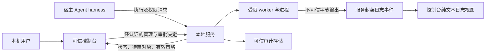

# 可信控制面与本地服务接口需求

状态：M0 提案；没有已实现或已冻结的服务合同版本。沿用 v0.2 §11.2 方法名用于映射；新增需求只描述语义，不发布端点、JSON schema 或某种 UI 框架。

## 控制面、请求面与数据面

控制台可发起敏感操作，最终授权始终在服务端。服务校验认证主体、角色、对象归属、策略版本、当前路径/资源和能力；UI 禁用按钮只改善交互，不构成权限校验。宿主 harness 的可信路由也不意味着模型生成的请求可信。

模型/负载只能请求增量权限，不能调用 `approval.resolve`、取得 grant 凭证或通过日志创建有效审批事件。即使某实现把请求与审批复用一个传输，也必须由服务按不可伪造的身份逐方法授权；仅检查 `initialize.role="admin"` 不合格。服务不得把控制 socket、管道、管理端口、令牌或可利用的继承句柄暴露给负载，负向验证由安全/运行时共同完成。

不自动假设所有命令都进入沙箱。管理诊断、安装器动作与业务工具的执行路由由产品策略和服务合同定义；UI 显示所选路由及边界。被明确允许的非沙箱操作必须独立授权并直称“非沙箱执行”，不能包装成更强沙箱模式；原方案默认关闭此能力。

## 形态与本地鉴权候选

| 形态 | 候选认证与可信来源 | 攻击面/实现负担 | 分发及平台影响 |
|---|---|---|---|
| 本地浏览器＋本地服务 | 可信本机启动器引导的一次性配对，再建立限权短期管理会话；Agent 用独立身份 | HTTP/WebSocket 暴露、CSRF、DNS rebinding、恶意站点/扩展、伪造本地服务、令牌泄漏；loopback 不是身份 | 不需选定桌面壳；需规定浏览器支持范围、端点发现、资源与服务配对；端口冲突及多用户会话需测试 |
| 桌面壳＋平台 IPC | 经可信启动引导，结合 OS 对端凭据/访问控制与服务角色授权 | 不可信渲染内容到特权桥接、导航/深链、IPC sender 校验、更新链；本地 IPC 不自动可信 | 每 OS/架构分别打包、签名/安装与升级验证；若携带 Web/语言运行时，还承担其更新和兼容责任 |
| CLI/TUI＋stdio 或受保护 IPC | 已验证的宿主启动服务，私有管道传递受限身份上下文；审批由可信交互入口完成 | executable 路径替换、句柄继承、控制和负载流混用、终端转义注入；自动化调用不能冒充人类批准 | 安装和可访问性路径不同；无 GUI 不能默认为已满足产品对管理控制台的期望；stdio 多客户端中介仍待设计 |

三者都可作为评审候选；没有任何框架获批。建议优先收敛 C1/C2/C4 的语义，再以首发平台、安装恢复、可访问性和威胁模型选形态。CLI 可作为诊断辅助，不因实现成本较低就自动代替所需管理入口。

| 本地鉴权方案 | 必需约束 | 不能作出的推论 |
|---|---|---|
| 私有 stdio | 可信启动路径和服务实例绑定；只向预期进程传递控制句柄；负载 stdout 单独封装；断管归属明确 | 持有任意管道、同一用户名或知道 session ID 不等于有审批权 |
| Unix socket / Windows named pipe | 平台适配验证对端身份，设置受保护端点与最小访问控制；限定本机/用户/登录会话范围；每次操作再鉴权 | Linux 的凭据和权限语义不能直接当作 macOS 保证；管道名/默认 ACL 不是认证方案 |
| loopback HTTP | 仅绑定预期 loopback 地址，拒绝外部监听；校验精确 Host/Origin 与 WS 握手，缺失/null 来源明确拒绝或走独立已认证非浏览器通道；cookie 模式含 CSRF 防护 | 随机端口、CORS、Origin 或本机 IP 单独都不认证用户；无 cookie 也不自动消除所有跨站风险 |

凭证不得出现在 URL、argv、负载环境、浏览器持久本地存储、诊断包或日志中。配对方式、凭证保管、撤销/轮换、服务真实性和同用户恶意进程的威胁范围需由 C4 定稿；这些需求不是一个已经实现的认证协议。安装特权与日常管理权限分开，控制台不因为安装曾提权就继承管理员运行权。

## 审批内容与来源

审批只来自通过身份与版本校验的服务控制事件，并以服务查询的最新待审对象为准。审批区域明确显示服务实例/已验证身份、申请主体、环境/会话、待审 ID、创建时间和服务端到期时间；模型理由标为“请求方说明”，不得以其宣称的安全性替代服务计算的差异。

每次展示至少包括：原 policy hash 与版本、不可变请求摘要、argv 参数边界、cwd、环境增量的键与非秘密值/秘密引用、原执行 ID（失败后申请时）、拟新增的规范化资源与动作、允许期限/次数、硬拒绝与不可授权项。存在多个资源时逐项显示，不能只用“允许访问工作区”概括整个 HOME。服务负责路径规范化和当前资源身份确认；UI 不自己解析路径来判权。

示例（合成对象，非协议）：会话 S 使用环境 E 的 revision 7，申请者 Agent-A，请求 P，策略 H7。以下权限差异由服务返回，授权范围为一次，绑定请求摘要 Q，到期时间为服务显示的绝对时间。

| 维度 | 当前 | 请求后 | 审批呈现 |
|---|---|---|---|
| 文件 | 工作区内可写 | 额外合成目录 `fixtures/export` 可 create/write | 显示实际解析出的完整资源、动作及源/目标；不暗含 delete/rename/link 或其它目录 |
| 网络 | deny | deny | 明确未申请联网，避免把文件授权视为全网开放 |
| 执行隔离 | sandboxed | sandboxed | 未请求切换到非沙箱 |
| 保护条目 | 硬拒绝变更 | 仍硬拒绝 | 用户批准不能覆盖硬策略；受保护 Git 项歧义解决前不提供绕过选项 |

若 env 中有秘密，只显示键、秘密引用/变更标记与服务生成的绑定摘要，不泄露值；请求摘要仍必须绑定实际请求内容。不能安全呈现完整语义、出现未知安全字段、策略漂移或服务身份变化时，显示“无法安全审批，请刷新/升级”，禁用批准且服务仍须拒绝陈旧决定。

## 审批状态与竞争处理

1. `permissions.request` 只产生待审对象。服务检查硬上限、能力与候选增量，返回可批准范围；不可表达的限制不能通过审批变成可表达。
2. 控制台读取最新对象，展示差异与 once/session/deny 中服务允许的选择。默认不勾选扩大范围，不提供模糊“以后都允许”。
3. 用户明确决定后，控制台提交待审版本、决定和决定操作键；服务重新验证身份/角色、请求、策略、会话存活与期限，原子处理并写审计。
4. 同一待审对象多个窗口竞争，只有一个有效决定；其它窗口刷新最终状态。答复丢失先查询决定状态；未确定之前不换新键重复批准。
5. 批准只生成/登记 grant，不自动执行。可信宿主显式用**新 request key**、grant 引用及可选 `retry_of` 提交新的执行。模型只收到非秘密状态/ID。第一次请求可能已有副作用，失败后禁止静默重跑。
6. once 与 session grant 都绑定调用者、服务实例、会话、原策略版本、资源范围及有效期，并由服务在每次使用时核对。once 还绑定不可变请求，启动前原子消费；并发使用只允许一次。session 允许复用其资源范围，每个新请求重新评估，不要求复用同一命令摘要；错误调用者、过期或策略绑定不匹配仍须拒绝。
7. 拒绝/过期/撤销/会话关闭均不能靠迟到响应复活。撤销至少阻止新使用；已打开 FD 和存量网络连接的撤销效果必须单列。需要立即撤销时由服务终止相关执行/会话、关闭连接并报告结果，不宣称点击即已收回全部权限。

授权绑定命令文本不保证其引用的可变脚本未变化。若批准依赖具体脚本内容，需服务固定内容/快照摘要；否则必须按实际授予的资源权限解释批准，不能给用户“只会执行这段文本”的假保证。

## 日志只作数据

负载输出以 service-instance/session/exec/stream/sequence 标识封装；日志正文中的同名字段没有控制效力。原始二进制按 encoding 解码，非法 UTF-8 可显示替代字符或安全字节视图，保留“已转换”提示，不破坏协议 framing。

日志默认纯文本、惰性渲染。不执行 HTML/脚本，不把 JSON/Markdown“approve”解释成动作，不把 ANSI/OSC 控制序列送进有特权的终端；包括改标题、剪贴板、超链接、光标覆盖或隐藏文本的序列。需要颜色等有限格式时使用显式白名单并测试，默认无可点击负载链接。URL、路径和文件名均为不可信内容，不能自动打开、下载或执行。

日志分页与缓存有界，显示截断、丢弃量、缺口及保留期限；不可信内容不能伪装成可信审批卡或系统成功通知。诊断导出由服务按权限脱敏并提示可能包含业务内容，不能认为自动脱敏保证没有秘密。审计记录置于负载不可写的可信存储；UI 显示审计异常，审计失败是否阻止敏感操作由架构/安全合同明确，不能静默继续并标记“已审计”。

## 接口需求清单

“原有”指 v0.2 中的提议，不代表已实现；“新增”需在 PUSH-3 协调。每个可变操作须有服务端授权及可查询结果，幂等键不得被解释为外部副作用 exactly-once。

| ID / 能力 | 请求与服务返回的最少语义 | 状态更新、失败与版本要求 |
|---|---|---|
| I01 初始化（原有 initialize） | 协议范围、已认证主体/角色、服务实例、控制台/服务/后端版本、能力、自检时间 | 不接受自报角色；无交集拒绝；未知安全语义禁写；服务重启可识别 |
| I02 诊断（CLI doctor；管理接口新增） | 所需能力与实际 supported/unsupported/unverified、安装/权限/依赖原因、清理级别 | 按需重检；缺必需能力 fail-closed；不能把 OS 名称当能力保证 |
| I03 环境配置（新增） | 列表/读取含 revision/schema/可信来源；校验、保存含 expected revision 和操作键 | 原子保存；冲突返回现版供合并；草稿和有效策略分离；未知字段不忽略 |
| I04 策略解释（原有 policy.explain） | 请求策略与 EffectivePolicy 差异、硬/软边界、不可表达项、policy hash | 诊断结果不授权将来执行；必要时重新解析资源 |
| I05 会话（原有 create/get/close，管理列表/附着新增） | 环境 revision、所有者绑定、工作区模式、权限上限、后端/能力快照、session ID | 准备失败无负载；关闭幂等、撤销与清理进度可查；多客户端拓扑 C2 定稿 |
| I06 执行（原有 exec.start） | session、argv/cwd/env、初始 stdin、超时、request key、可选 grant/retry_of | 同会话同 key 同内容返回原 exec，不同内容冲突；ACK 丢失可按 key 查询；崩溃后未知不盲重放 |
| I07 文件 worker（原有 file.*） | 同会话策略、操作 ID、路径/双端、大小上限、原内容摘要/版本 | 边界检查与执行在受限 worker；冲突不静默覆盖；UI 不直接读写宿主兜底 |
| I08 状态/取消（原有 exec.status/wait/cancel） | 对象与操作键；权威状态 revision、结束原因、时间、部分结果 | 取消幂等；明确 accepted 与 terminated；查询/取消不可因 UI 无响应而丢失授权校验 |
| I09 事件与快照（扩展原有 output/completed） | 实例/对象、序号、状态 revision、stream/encoding、截断、游标与留存范围 | 有序合并、去重；缺口重取快照；观察重连不等于恢复任务；背压归属见 C2 |
| I10 待审与决定（原有 request/requested/resolve；查询新增） | 完整权限差异、来源/绑定/期限、待审版本、决定操作键与服务确认 | 仅可信角色可 resolve；陈旧/重复/并发/过期/跨会话拒绝；批准不自动执行 |
| I11 授权撤销（新增显式管理需求） | 非秘密 grant 标识、对象权限、撤销范围；新操作/存量执行效果 | 服务返回实际撤销和终止/连接关闭结果，UI 不许承诺瞬时收回 |
| I12 清理状态与恢复（新增） | 资源类别/服务登记 ID、归属、逐项结果、保证级别、残留、允许重试范围 | exec 完成与 cleanup 完成独立；幂等恢复必须重验证归属；不用 UI 传任意删除路径 |
| I13 审计/日志查询导出（新增） | 有界过滤/分页、可见范围、脱敏、保留期限、审计健康状态 | 授权逐项检查；区分负载与审计；导出失败不泄露秘密错误体 |
| I14 升级迁移（新增） | 版本配对矩阵、迁移计划/备份/状态、回滚兼容性 | 由服务/安装器执行；不兼容禁写；不迁移 grant；操作失败可查而非重试即重装 |

共用错误至少区分：身份失败、权限拒绝、对象不可见、版本不兼容、配置冲突、能力不足、策略无法表达、准备失败、服务不可用、结果未知、清理不完整。返回安全的 reason code、关联 ID、可重试条件和可见字段，不把内部路径/凭证堆栈直接交给用户。无权看见的对象不能通过错误差异泄露存在性。

架构需固定事件顺序、快照一致性、请求/输出上限、超时、留存、故障恢复范围及审计失败模式，随后给出可测试版本。上述字段缺失时控制台应明确“不支持/未知”，不能本地补造成功值。

## 一手资料与适用范围

核查日期：2026-10-22。下列资料支持攻击面判断，不证明本项目安全或跨平台兼容；需求是据此提出的设计推论。

- [RFC 8252 §8.1–8.3](https://www.rfc-editor.org/rfc/rfc8252.html#section-8.1)：讨论原生应用 OAuth loopback 回调可能被其他应用截获；不把其 OAuth 方案直接当通用管理 HTTP 认证。
- [OWASP CSRF Prevention](https://cheatsheetseries.owasp.org/cheatsheets/Cross-Site_Request_Forgery_Prevention_Cheat_Sheet.html#using-standard-headers-to-verify-origin)：服务端来源校验和 CSRF 防护；支持浏览器变更操作须防跨站的要求，不能替代用户身份。
- [Microsoft Named Pipe Security](https://learn.microsoft.com/en-us/windows/win32/ipc/named-pipe-security-and-access-rights)：默认权限、登录 SID 及细粒度管道权限；支持显式最小 DACL 的要求，不声称默认管道仅本用户可用。
- [Linux unix(7)](https://man7.org/linux/man-pages/man7/unix.7.html)：SO_PEERCRED、pathname 与 abstract socket 权限差异；只作为 Linux 依据，不外推 macOS/BSD。
- [Electron Security](https://www.electronjs.org/docs/latest/tutorial/security)：远程内容、特权桥接、导航与 IPC sender 风险实例；不构成 Electron 选型，也不代表所有桌面壳采用相同机制。
