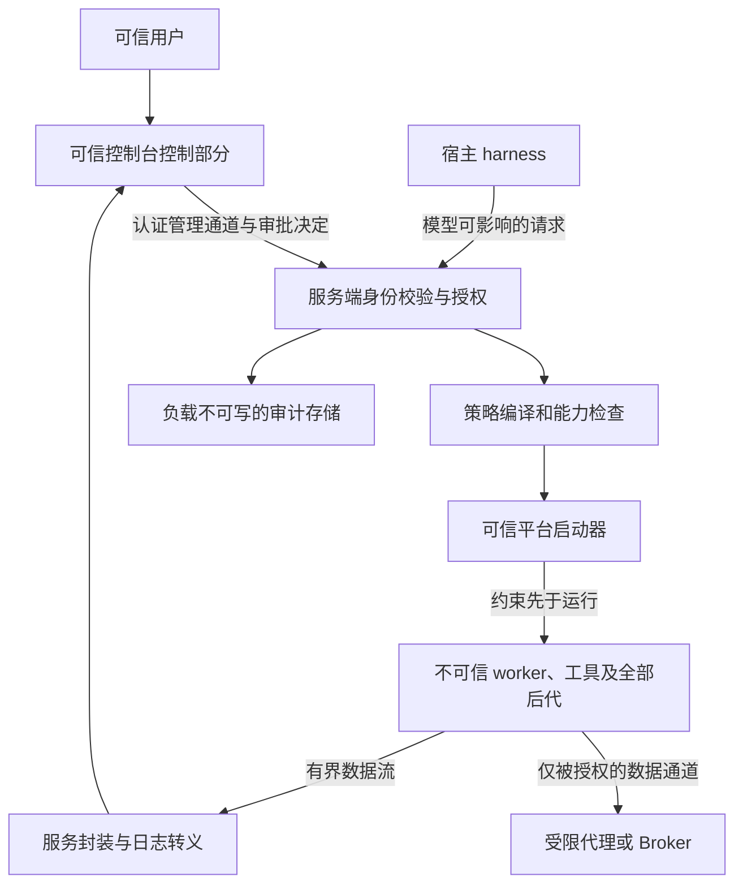

# M0 威胁模型与平台能力矩阵

PUSH-4，2026-11-04。沿用设计 v0.2 的**候选 D1**进行评审：不可信用户态程序可能主动绕过限制；内核、管理员与经验证安装的可信组件属于信任基础。D1 仍待用户确认，此文不扩大或缩小最终产品承诺。当前 M0 只运行固定合成代码，尚未实现以下产品边界。

## 主体、资产与边界

| 主体 | 信任范围 | 不得推导的权限 |
|---|---|---|
| 本机用户、可信策略管理员 | 从可信管理入口制定硬上限、决定允许的软权限增量 | 用户点击批准也不能越过组织/管理硬拒绝 |
| supervisor、平台 launcher/helper、可信代理/Broker | 身份验证、策略编译、授权消费、受限启动、清理、审计 | 不因组件可信就直接以宿主权限执行任意模型文件操作 |
| 宿主 Agent harness | 正确路由工具、保管控制凭证、转交可信决定 | 模型生成的参数、项目配置、理由文本仍不可信；不是审批主体 |
| 控制台可信控制部分 | 验证服务身份、显示服务端有效策略和差异、提交人类决定 | UI 按钮、URL 参数、客户端自报角色不授权；日志渲染区域不继承审批能力 |
| 模型、仓库、依赖脚本、被调用工具及其全部后代 | 不可信；可能执行任意用户态操作、伪造输出、制造竞态 | 不能自批、持有 grant 秘密、修改控制文件或通过宿主代理越界执行 |
| 网页、浏览器/MCP/远程连接器、其他本机客户端 | 独立攻击面；逐接口鉴权 | 未经网关的能力不自动纳入沙箱；loopback/同 UID 不自动构成审批身份 |

资产包括宿主与工作区文件（内容及对象身份）、受保护 Git/Agent 配置、真实秘密、模型 API 凭据、进程和句柄、控制通道与 grant、网络目标、CPU/内存/进程/输出预算、审计真实性和可用性。安装器、升级包、helper 选择、诊断导出也能影响这些资产。

控制与数据通道必须分开到资源、凭证和解析器：负载 stdin/stdout 是数据管道；模型可调用面可申请权限，但不能解析或调用可信审批决定方法。负载打印看似有效的 JSON、事件 ID、HTML 或终端控制序列，不得成为控制消息。审批 ID 是相关标识，不是授权凭证。所有读、写、执行、搜索、取消、日志查询与管理请求均验证对象归属和当前权限；UI 显示的 EffectivePolicy 必须来自服务端实际编译结果。

## 主要威胁与要求

| 攻击路径 | 必需控制 / 验证目标 | 当前证据 |
|---|---|---|
| 混淆请求者、审批者与 grant 使用者 | 服务认证主体；管理与工具角色分离；控制句柄不进入负载；逐方法和对象鉴权；拒绝自报 admin | 草案，未实现；AUTH 用例均待真实服务 |
| 宿主代执行绕开进程容器 | 不暴露 Docker/SSH agent/桌面会话 socket、D-Bus、Mach/XPC、WMI/COM/RPC、服务/计划任务等未授权接口；测试从已受限负载发起的调用 | Linux 仅 abstract Unix 合成 socket；其他未覆盖。Windows Job 管理已归组进程，不证明宿主代执行安全 |
| helper/Python/动态加载路径被工作区替换 | 固定可信安装路径、对象/签名及所有权检查、最小环境、启动前核对；仓库配置不能指定 helper | bwrap 路径检查已静态审查；两平台使用固定 Python 脚本；生产安装更新链未验证 |
| 文件别名与路径竞态 | 文件 ID/卷 ID 或 dev/inode 等对象身份、受控父目录/句柄、操作类型及 rename/link 双端校验；所选内核机制必须覆盖实际访问 | 两项已知绕过实测；realpath 与过滤复制的局限另有合成证据；完整保护失败 |
| 已打开 FD/handle、进程调试或内存访问 | 不继承控制/secret/Job 句柄；限制 ptrace、进程 handle 获取、共享内存和原生 IPC；需要即时撤销时终止相关执行 | `close_fds=True`/Windows 不继承句柄为代码事实，不等于完整攻击矩阵实测 |
| 网络、代理及 IPC 出口 | deny 必须在 OS 层强制；本地可达正向对照；代理身份与出口绑定，故障不直连；IPv6/UDP/DNS/重绑定/协议旁路单独验证 | WSL 部分本地通信实验通过；Windows/macOS deny 无证据；代理未实现 |
| 秘密通过环境、输出或产物泄漏 | 宿主长期秘密不下发；环境 allowlist；输出作为不可信字节有界处理；审计和导出脱敏、限权 | Linux 单合成变量清理通过。Windows 固定子程序仍继承环境。断网不阻止 stdout/产物经宿主上传 |
| fork/setsid、breakaway、资源耗尽、清理竞态 | 受管全树、启动前硬配额、前台确认清理；超时/断连/崩溃各自测试；状态区分命令退出和清理完成 | 已观察 Linux 合成后代及 Windows 单进程生命期通过；完整恶意进程树、硬资源配额未验证 |
| 日志伪装成可信审批、UI 注入 | 日志只作转义文本；ANSI/OSC/HTML/Markdown 不触发桥接、剪贴板或动作；可信卡片由经过认证的服务事件建立 | PUSH-8 草案明确要求；无真实 UI 验证 |
| 安装/升级/卸载和诊断包越权 | 最小账户/ACL/网络变更、版本配对、迁移不扩权、签名校验与回滚、凭证不迁移到日志、归属验证后清理 | 未实测；不得借本次研究合并放行发布 |

Windows 文档明确：通过 `Win32_Process.Create` 创建的进程不随调用者自动关联到 Job。这支持把宿主代执行 IPC 列为独立威胁，**不表示本轮调用过 WMI**。[Microsoft Job Objects](https://learn.microsoft.com/en-us/windows/win32/procthread/job-objects)

本地管理端点需采用选定平台可验证的对端身份及最小访问控制。若选择浏览器 HTTP/WebSocket，必须同时设计服务真实性、用户/角色鉴权、精确监听范围、Host/Origin/CSRF 与会话撤销；这些是拟议控制，尚未选型。Windows named pipe 的默认 DACL 包含向 Everyone/anonymous 授予读取，因此不能假设默认命名管道私有；应限制用户与登录会话并防远端访问。[Microsoft Named Pipe Security](https://learn.microsoft.com/en-us/windows/win32/ipc/named-pipe-security-and-access-rights)

## 能力矩阵

“已验证”只对应本轮明确断言；“已失败”阻断该保护承诺；“未覆盖”不计为通过。代码存在、配置标志、mock 或统一接口都不是隔离等价性证据。

| 能力 | Windows 本轮 | WSL2 Linux 本轮 | macOS | 依赖、拒绝和证据边界 |
|---|---|---|---|---|
| 固定合成负载启动 | 已验证先归组后 resume | 已验证 user/pid/net/ipc/uts namespace 启动 | 未覆盖 | Windows Job/创建进程 API；Linux 可信 bwrap 0.11.1 与可用 userns；失败不得启动用户负载 |
| 文件读写与现有子树保护 | 未覆盖 ACL/token | 普通读写、外部合成 symlink 拒绝、已有只读子树测试通过 | 未覆盖 | Linux `/usr` 宽只读不是 scoped read；Windows 没有文件隔离 |
| hardlink/未来名称 | 后端未实现；仅合成 shortcut 反例 | 两项已失败 | 未覆盖 | 对象/视图方案未成立时拒绝策略；不能靠 realpath 或启动扫描 |
| 父目录/工作区根替换 | 仅独立路径实验，不是隔离验证 | 已有保护挂载根 rename 拒绝；其他祖先/竞态未覆盖 | 未覆盖 | 需要对象锚定与不可替换的导入/导出边界 |
| 网络 deny | 未实现 | loopback IPv4/IPv6 TCP/UDP、abstract Unix 通过；全量未覆盖 | 未覆盖 | net namespace 证据不可外推 WFP/Seatbelt；缺完整所需能力则拒绝 |
| 根退出后回收 | Job 关闭杀死单个固定进程 | 一个固定 setsid 子进程退出并被收集 | 未覆盖 | 不证明所有后代、breakaway、supervisor 崩溃和断连 |
| 初始化故障清理 | Job 配置、归组、resume 失败已测 | 已观察合成后代的准备失败已测 | 未覆盖 | 记录真实进程 handle 或 PID/starttime；未确认清理必须显式失败 |
| 文件临时目录清理 | 固定目录 symlink 哨兵通过 | 固定目录 symlink 哨兵通过 | 未覆盖 | Windows junction/reparse、并发替换、mount 边界另验；不用 UI 任意路径删除 |
| 全树资源/控制句柄/宿主代理 | 未覆盖 | 未覆盖 | 未覆盖 | 不支持要求即拒绝，不回退到无约束执行 |
| 可信审批/工具路由/真实控制台 | 未实现 | 未实现 | 未实现 | 不可信模型不能自批是底线，不因 D1 待决取消 |
| 安装、升级、回滚、卸载 | 未覆盖 | 未覆盖 | 未覆盖 | 本轮没有改变宿主设置；正式候选依赖须单列授权和恢复验证 |

Linux 内核文档把能力按 ABI 区分；本项目需按策略所需能力探测，不能从内核版本或某个 Landlock ABI 推定全部隔离可用。本轮未安装 Landlock 规则。[Linux Landlock 文档](https://docs.kernel.org/userspace-api/landlock.html) bubblewrap 是由调用者构建安全策略的底层机制；本探针参数不是产品安全合同。[bubblewrap 官方说明](https://github.com/containers/bubblewrap)

## 不覆盖的威胁与未作出的承诺

按候选 D1，不承诺抵御内核漏洞、管理员/物理攻击及所有侧信道；已能任意修改或调试可信 supervisor 的宿主同用户恶意进程通常不在当前保护范围。但是，**沙箱负载利用 IPC、句柄或调试路径影响宿主仍在必须防御范围内**，不能用“同用户不可信进程不覆盖”排除它。若产品改变这一边界，需重新评审 D1 和平台路线。

已授权文件可能被删除，已授权网络服务可能承载外泄，用户随后在宿主执行被修改脚本也可能产生副作用；沙箱不是备份或事务。受控副本只隔离部分写入风险，导入秘密别名与导回恶意控制文件仍需防御。外部工具若不经过网关，不属于沙箱安全保证。上述边界不能用于掩盖已承诺但尚未实现的限制。
